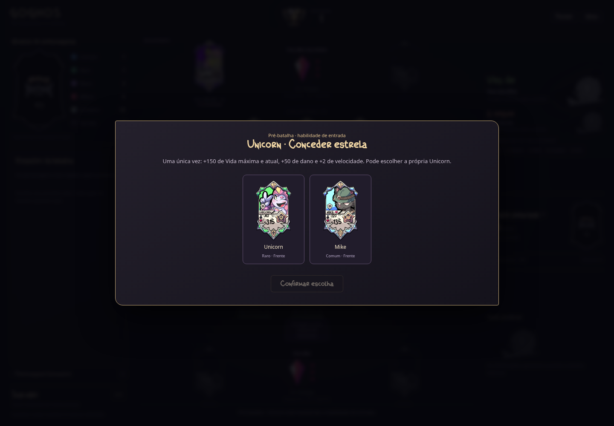

# GOGHOS TCG

Protótipo jogável de cartas e batalha por turnos. A versão **0.21.0** reúne **30 personagens oficiais**, com suas habilidades, e remove os personagens provisórios. **Petra fica de fora por enquanto**, conforme solicitado. As cartas usam as bases completas recebidas, com os valores atuais sobrepostos nos campos numéricos.

## Jogar e desenvolver

Abra `index.html` no navegador. O jogo roda localmente, sem conta, servidor ou internet. Para servir os arquivos durante o desenvolvimento, execute `npm run dev` na raiz do projeto e acesse `http://localhost:8000`.

Em **Jogar**, escolha um Comum. O bot escolhe outro, e cada equipe recebe **um Raro sorteado automaticamente**, sem repetição. Confira as quatro cartas e clique em **Play · começar batalha**. Ambas as equipes começam com dois personagens na frente.

**Testar novos personagens** oferece uma formação para cada um dos 30 oficiais, com busca por nome e descrição da habilidade. As escolhas de entrada aparecem na pré-batalha; as ações específicas aparecem na vez do personagem. **Personagens** mostra o catálogo com as cartas e as regras de cada habilidade. Os atalhos **Testar Sark** e **Testar Elétrica e John** continuam disponíveis.

Foram adicionados combo de Sam, míssil com dano nos vizinhos, paralisia, duelo do Sheriff, hipnose, almas, queimaduras, cura total, caça sorteada, estado Oni, estrela de Unicorn, execução por dado, sono, petrificação, proteção de Z-Zus, Swarm de Alex, amizade de Karma e esquiva progressiva de Trucc. As regras completas estão no [guia dos personagens](docs/PERSONAGENS_PENDENTES.md).

É necessário **Node.js 20 ou superior** para rodar os testes e **Python 3** para `npm run dev`. Não há pacotes externos nem etapa de instalação:

```sh
npm test
```

## Onde está cada parte

| Caminho | Conteúdo |
| --- | --- |
| `js/data/` | Personagens, cartas de Apoio e cartas do monte principal |
| `js/core/` | Regras da batalha, seleção, IA, montes e recuperação |
| `js/ui/` | Telas, cartas, mão e mensagens |
| `assets/` e `css/` | Arte recebida, conceitos, fontes e aparência |
| `tests/` | Regras atuais e testes da interface com DOM simulado |
| `docs/` | Regras completas e histórico das versões recebidas |

[Regras e decisões provisórias](docs/REGRAS.md) · [Validação e imagens](docs/VALIDACAO.md) · [Artes recebidas](docs/ARTES.md) · [Histórico](docs/HISTORICO.md) · [Como contribuir](CONTRIBUTING.md)

## Estado do protótipo

A partida pode ser concluída contra a IA. Há seis montes de personagens, monte principal, mão de cinco cartas, cartas de Apoio, pré-batalha, habilidades individuais, recuperação sem reiniciar a velocidade e vitória ao eliminar a Daly Mãe adversária. Vida, dano e cura são arredondados para cima em múltiplos de 5. O contador da Daly Mãe perde uma vida por ataque.

Item, Habilidade Especial e Loja continuam em desenvolvimento. As habilidades dos 30 personagens presentes estão implementadas; Petra aguarda sua mecânica. Sem ação possível, é possível avançar o ciclo e comprar cartas; com os recursos esgotados e sem efeitos a resolver, há empate.



[Seleção atual](docs/previews/selecao-v0.21.0-desktop.png) · [Arena no celular](docs/previews/arena-v0.21.0-celular.png)
