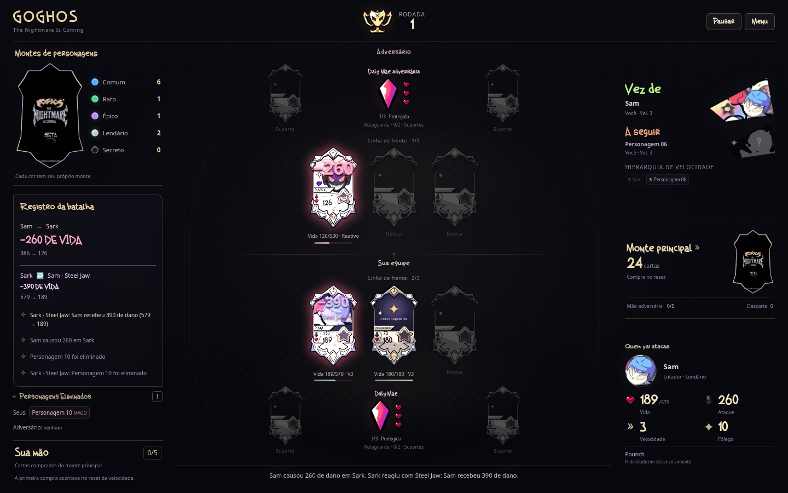
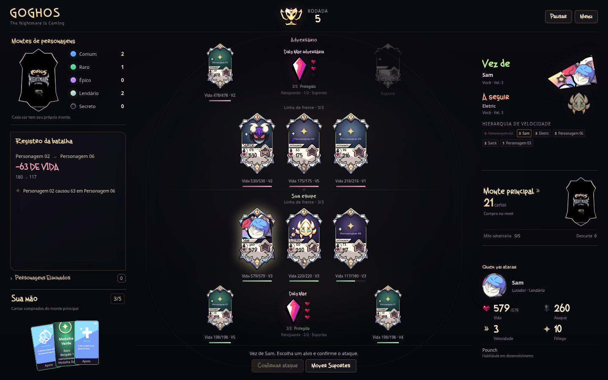

# GOGHOS TCG

Protótipo jogável de cartas e batalha por turnos. A versão **0.18.0** implementa **Steel Jaw, do Sark**: um Assassino Lendário com 530 de Vida e 5 de fôlego, sem ataque básico ou velocidade. Ao ser atacado, recebe o dano e reage automaticamente conforme a raridade do atacante. A arena, a seleção alternada de Comuns e a continuidade da hierarquia após recuperação foram preservadas.

## Jogar e desenvolver

Abra `index.html` no navegador. O jogo roda localmente, sem conta, servidor ou internet. Para servir os arquivos durante o desenvolvimento, execute `npm run dev` na raiz do projeto e acesse `http://localhost:8000`.

Para experimentar a habilidade sem depender dos montes, clique em **Testar Sark** no menu. Escolha **Eu ataco o Sark** para controlar os atacantes ou **Sark na minha equipe** para observar a reação contra a IA. **Jogar** mantém a seleção normal. Nas partidas normais, Sark está no monte Lendário e pode entrar por uma medalha Holográfica.

É necessário **Node.js 20 ou superior** para rodar os testes e **Python 3** para `npm run dev`. Não há pacotes externos nem etapa de instalação:

```sh
npm test
```

## Onde está cada parte

| Caminho | Conteúdo |
| --- | --- |
| `js/data/` | Personagens, cartas de Apoio e cartas do monte principal |
| `js/core/` | Regras da batalha, seleção, IA, montes e recuperação |
| `js/ui/` | Telas, cartas, mão e mensagens |
| `assets/` e `css/` | Arte recebida, conceitos, fontes e aparência |
| `tests/` | Regras atuais e testes da interface com DOM simulado |
| `docs/` | Regras completas e histórico das versões recebidas |

[Regras e decisões provisórias](docs/REGRAS.md) · [Validação e imagens](docs/VALIDACAO.md) · [Artes recebidas](docs/ARTES.md) · [Histórico](docs/HISTORICO.md) · [Como contribuir](CONTRIBUTING.md)

## Estado do protótipo

A partida já pode ser concluída contra a IA. Há seleção inicial, cinco montes de personagens, compra do monte principal, cartas de Apoio, Esquiva, mana, recuperação e vitória ao eliminar a Daly Mãe adversária. Sem atacantes, é possível avançar o ciclo e comprar; com o monte vazio e nenhuma medalha utilizável nas mãos, há empate. A Loja, Item, Habilidade Especial e as habilidades dos outros personagens continuam em desenvolvimento. Sam, Eletric e Sark têm ilustrações recebidas e aparecem em **Personagens** no menu. Os outros nomes e retratos ainda são provisórios; Sark usa os atributos e a habilidade confirmados pelo criador.



Formação de exemplo para revisar o visual e o enquadramento das ilustrações:


