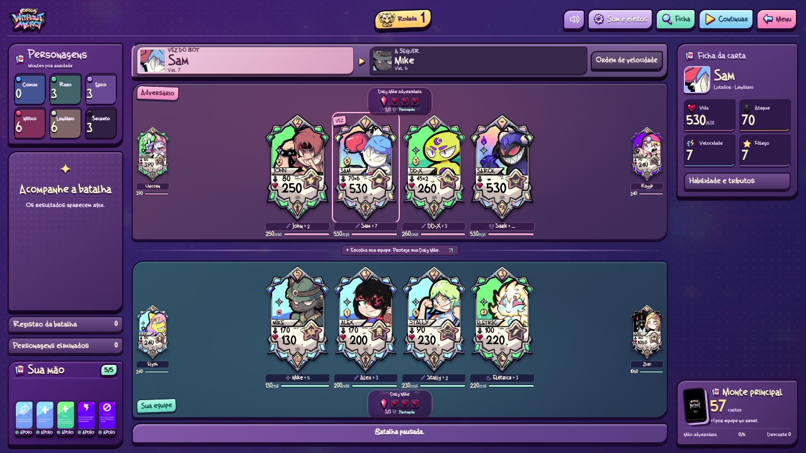

# GOGHOS — Without Mercy

Um jogo de cartas e batalhas por velocidade no universo **GOGHOS**. A versão **0.29.1** mantém a batalha inteira na tela, com consultas paginadas e a fonte original German Beauty restaurada. A direção visual leva a direção cartoon para a experiência de jogo: seleção, campo de batalha, mão, decisões, fichas, catálogo, laboratórios, loja, crônicas, preferências e resultados. As cartas oficiais permanecem intactas dentro dos novos painéis.

**O balanceamento foi preservado.** Os dez arquivos do motor, os atributos e habilidades dos 31 personagens, Zeenneriam, os Apoios e as regras são os mesmos da v0.26.2. As cartas oficiais continuam intactas. O novo kit entra como arte e apresentação, sem substituir números por referências antigas.



## Novidades visuais

- **Seleção:** quatro cartas oficiais em pedestais, marcações de equipe e Play após as escolhas. Mantém somente os controles e cartas necessários.
- **Batalha:** campo dividido por cores de equipe, montes empilhados, painel de velocidade, atributos em peças próprias, alvos e comandos destacados. As cartas conservam arte, números e tamanho legível.
- **Mão e decisões:** leque vertical de até cinco cartas, indicação de compra/seleção e painéis de recuperação, avanço de Suportes e substituição com hierarquia clara.
- **Golpes:** impactos com contornos de quadrinhos, luva de soco, fogo angular, feixes, raios, escudos, portais e trilhas entre origem e alvo. Golpes múltiplos continuam separados e cada resultado vem do motor.
- **Catálogo e treinos:** cartas em destaque, metadados por raridade/classe, busca e habilidades expansíveis no catálogo. Os 31 laboratórios e os 17 Apoios continuam disponíveis.
- **Loja e crônicas:** baú sobre palco, cartões de cosméticos, faixa de visuais equipados, revelação animada e cenas em quadros com balões de texto. Economia e progresso anteriores preservados.
- **Preferências e resultados:** controles em blocos e placar de fim de partida. Fonte e ícones locais, movimento reduzido e som configurável. Menu e abertura da v0.28 continuam disponíveis.

[Vídeo do jogo atualizado](docs/previews/jogo-v0.29.0.mp4) · [Arena no celular](docs/previews/arena-v0.29.0-celular.png) · [Seleção](docs/previews/selecao-v0.29.0-desktop.png) · [Mão cheia](docs/previews/mao-cheia-v0.29.0-celular.png) · [Loja](docs/previews/loja-v0.29.0-desktop.png) · [Guia da interface](docs/UI.md)

## Jogar e desenvolver

Abra `index.html` no navegador. O jogo roda localmente, sem conta, servidor ou internet. Extraia o ZIP completo antes de abrir o arquivo. A fonte Lilita One é distribuída localmente com sua licença livre. O som começa depois de uma interação; volume e movimento podem ser ajustados pelo ícone de preferências. Para servir os arquivos durante o desenvolvimento, execute `npm run dev` na raiz do projeto e acesse `http://localhost:8000`.

Com **Arena** selecionada, **Jogar** apresenta Elysh, Stally, Mike e Alex. A escolha alterna **você → bot → você → bot**, sem repetir cartas. Depois das quatro escolhas, clique em **Play · começar batalha**. Cada equipe começa com seus dois Comuns na frente; não são sorteados Raros.

No seletor de modos, **Treino de campeões** oferece uma formação para cada um dos 31 oficiais, com busca por nome e descrição da habilidade. As escolhas de entrada aparecem na pré-batalha; as ações específicas aparecem na vez do personagem. **Personagens** mostra o catálogo com as cartas e as regras de cada habilidade. **Mesa de Apoios** inclui os 17 efeitos; **Invocação primordial** prepara os três fragmentos para a invocação manual. Os **Atalhos de treino** mantêm os testes de Sark e Elétrica e John. A escolha do modo vale enquanto o jogo estiver aberto; recarregar retorna à Arena.

Foram adicionados combo de Sam, míssil com dano nos vizinhos, paralisia, duelo do Sheriff, hipnose, almas, queimaduras, cura total, caça sorteada, estado Oni, estrela de Unicorn, execução por dado, sono, petrificação, proteção de Z-Zus, Swarm de Alex, amizade de Karma e esquiva progressiva de Trucc. As regras completas estão no [guia dos personagens](docs/PERSONAGENS_PENDENTES.md). A [revisão de balanceamento](docs/BALANCEAMENTO.md) lista todos os valores anteriores, atuais e justificativas.

As cartas da mão podem ser usadas na vez da equipe mesmo se o personagem estiver imobilizado ou sob outro impedimento. Isso não gasta a ação nem remove o efeito. Magos mantêm 3 de mana inicial, +1 por ação concluída e máximo de 3.

É necessário **Node.js 20 ou superior** para rodar os testes e **Python 3** para `npm run dev`. Não há pacotes externos nem etapa de instalação:

```sh
npm test
```

## Onde está cada parte

| Caminho | Conteúdo |
| --- | --- |
| `js/data/` | Personagens, cartas de Apoio e cartas do monte principal |
| `js/core/` | Regras da batalha, seleção, IA, montes e recuperação |
| `js/ui/` | Telas, cartas, mão e mensagens |
| `assets/` e `css/` | Arte recebida, conceitos, fontes e aparência |
| `tests/` | Regras atuais e testes da interface com DOM simulado |
| `docs/` | Regras completas e histórico das versões recebidas |

[Conferência de classes e tributos](docs/CLASSES.md) · [Invocação e tributos](docs/DEUSES.md) · [Cartas de Apoio](docs/APOIOS.md) · [Balanceamento](docs/BALANCEAMENTO.md) · [Regras e decisões provisórias](docs/REGRAS.md) · [Validação e imagens](docs/VALIDACAO.md) · [Artes recebidas](docs/ARTES.md) · [Histórico](docs/HISTORICO.md) · [Como contribuir](CONTRIBUTING.md)

## Estado do protótipo

A partida pode ser concluída contra a IA. Há seis montes de personagens, monte principal, mão de cinco cartas, cartas de Apoio, pré-batalha, habilidades individuais, recuperação sem reiniciar a velocidade e vitória ao eliminar a Daly Mãe adversária. Vida, dano e cura são arredondados para cima em múltiplos de 5, com a exceção confirmada de Morto Vivo voltando com 1 de Vida. O contador da Daly Mãe perde uma vida por ataque.

Item e Habilidade Especial continuam em desenvolvimento. O Santuário oferece a loja de baús e visuais, separada das regras de combate. As habilidades dos 31 personagens presentes estão implementadas; Petra aguarda sua mecânica. Sem ação possível, é possível avançar o ciclo e comprar cartas; com os recursos esgotados e sem efeitos a resolver, há empate.


[Seleção no celular](docs/previews/selecao-v0.29.0-celular.png) · [Crônicas](docs/previews/cronicas-v0.29.0-celular.png) · [Guia da interface](docs/UI.md) · [Atualizações anteriores](docs/HISTORICO.md)
