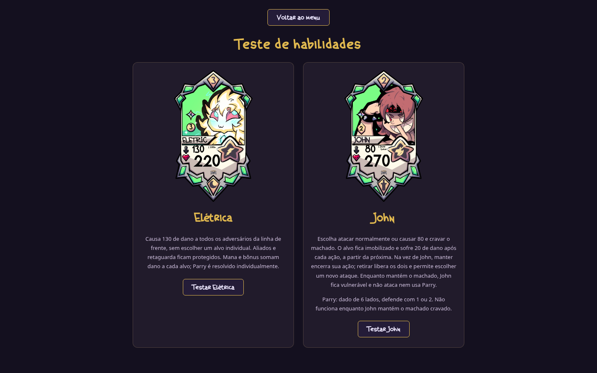
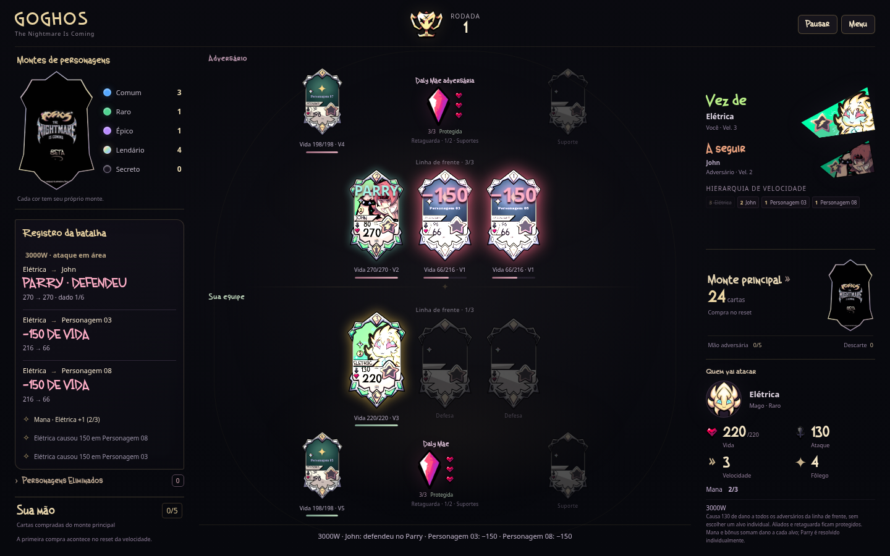

# GOGHOS TCG

Protótipo jogável de cartas e batalha por turnos. Na versão **0.19.1**, Vida, dano e cura dos personagens usam múltiplos de 5, sempre arredondando para cima: 211 vira 215 e 216 vira 220. As habilidades de **Elétrica** e **John** continuam disponíveis: ataque em área contra a frente adversária, Parry com dado e machado que imobiliza e causa dano após cada ação. Os dois usam as bases completas recebidas. Sark continua recebendo o dano antes de reagir, somente se sobreviver.

## Jogar e desenvolver

Abra `index.html` no navegador. O jogo roda localmente, sem conta, servidor ou internet. Para servir os arquivos durante o desenvolvimento, execute `npm run dev` na raiz do projeto e acesse `http://localhost:8000`.

Para experimentar as novas habilidades sem depender dos montes, clique em **Testar Elétrica e John** no menu e escolha um deles. Elétrica ataca todos os adversários da frente com uma confirmação; John permite escolher entre ataque normal e cravar o machado. Na vez seguinte dele, é possível manter ou retirar o machado. Nas partidas normais, os dois estão no monte Raro e podem entrar por uma medalha Verde.

**Testar Sark** continua disponível para controlar os atacantes ou observar a reação contra a IA. Sark está no monte Lendário. **Jogar** mantém a seleção alternada de dois Comuns por equipe e a continuidade da hierarquia após recuperação.

É necessário **Node.js 20 ou superior** para rodar os testes e **Python 3** para `npm run dev`. Não há pacotes externos nem etapa de instalação:

```sh
npm test
```

## Onde está cada parte

| Caminho | Conteúdo |
| --- | --- |
| `js/data/` | Personagens, cartas de Apoio e cartas do monte principal |
| `js/core/` | Regras da batalha, seleção, IA, montes e recuperação |
| `js/ui/` | Telas, cartas, mão e mensagens |
| `assets/` e `css/` | Arte recebida, conceitos, fontes e aparência |
| `tests/` | Regras atuais e testes da interface com DOM simulado |
| `docs/` | Regras completas e histórico das versões recebidas |

[Regras e decisões provisórias](docs/REGRAS.md) · [Validação e imagens](docs/VALIDACAO.md) · [Artes recebidas](docs/ARTES.md) · [Histórico](docs/HISTORICO.md) · [Como contribuir](CONTRIBUTING.md)

## Estado do protótipo

A partida já pode ser concluída contra a IA. Há seleção inicial, cinco montes de personagens, compra do monte principal, cartas de Apoio, Esquiva, mana, recuperação e vitória ao eliminar a Daly Mãe adversária. Sem atacantes, é possível avançar o ciclo e comprar; com o monte vazio e nenhuma medalha utilizável nas mãos, há empate. A Loja, Item, Habilidade Especial e as habilidades dos demais personagens continuam em desenvolvimento. Sam, Elétrica, John e Sark têm ilustrações recebidas e aparecem em **Personagens** no menu. Os outros nomes e retratos ainda são provisórios; Sam aguarda sua base própria.



Ataque em área no computador:


