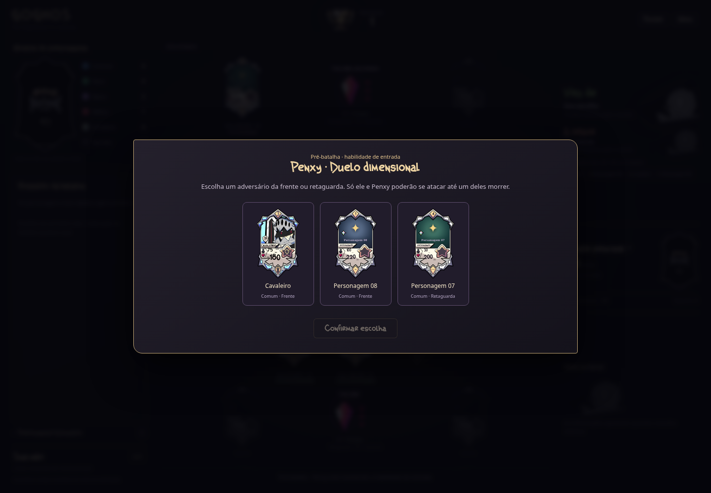

# GOGHOS TCG

Protótipo jogável de cartas e batalha por turnos. A versão **0.20.0** adiciona **Penxy, Cavaleiro, Zikssy, Elysh, DD-X e Vaglar**, com pré-batalha, duelo dimensional, armadura, susto com d6, cura por ação, ataque dobrado de uso único e livro de execução. A raridade **Mítica** fica entre Épica e Lendária; somente as faixas de Vida e Dano foram transferidas, preservando as cores das cartas. Vida, dano e cura continuam em múltiplos de 5, sempre arredondados para cima.

## Jogar e desenvolver

Abra `index.html` no navegador. O jogo roda localmente, sem conta, servidor ou internet. Para servir os arquivos durante o desenvolvimento, execute `npm run dev` na raiz do projeto e acesse `http://localhost:8000`.

Clique em **Testar novos personagens** no menu e escolha um dos seis. Penxy, Zikssy e Vaglar apresentam sua habilidade de entrada antes de liberar os ataques; as mesmas escolhas aparecem quando chegam por medalha ou recuperação. Cavaleiro também passa a participar da seleção normal de Comuns.

Para experimentar as novas habilidades sem depender dos montes, clique em **Testar Elétrica e John** no menu e escolha um deles. Elétrica ataca todos os adversários da frente com uma confirmação; John permite escolher entre ataque normal e cravar o machado. Na vez seguinte dele, é possível manter ou retirar o machado. Nas partidas normais, os dois estão no monte Raro e podem entrar por uma medalha Verde.

**Testar Sark** continua disponível para controlar os atacantes ou observar a reação contra a IA. Sark está no monte Lendário. **Jogar** mantém a seleção alternada de dois Comuns por equipe e a continuidade da hierarquia após recuperação.

É necessário **Node.js 20 ou superior** para rodar os testes e **Python 3** para `npm run dev`. Não há pacotes externos nem etapa de instalação:

```sh
npm test
```

## Onde está cada parte

| Caminho | Conteúdo |
| --- | --- |
| `js/data/` | Personagens, cartas de Apoio e cartas do monte principal |
| `js/core/` | Regras da batalha, seleção, IA, montes e recuperação |
| `js/ui/` | Telas, cartas, mão e mensagens |
| `assets/` e `css/` | Arte recebida, conceitos, fontes e aparência |
| `tests/` | Regras atuais e testes da interface com DOM simulado |
| `docs/` | Regras completas e histórico das versões recebidas |

[Regras e decisões provisórias](docs/REGRAS.md) · [Validação e imagens](docs/VALIDACAO.md) · [Artes recebidas](docs/ARTES.md) · [Histórico](docs/HISTORICO.md) · [Como contribuir](CONTRIBUTING.md)

## Estado do protótipo

A partida já pode ser concluída contra a IA. Há seleção inicial, seis montes de personagens, compra do monte principal, cartas de Apoio, Esquiva, mana, recuperação e vitória ao eliminar a Daly Mãe adversária. Sem atacantes, é possível avançar o ciclo e comprar; com o monte vazio e nenhuma medalha utilizável nas mãos, há empate. A Loja, Item, Habilidade Especial e as habilidades dos demais personagens continuam em desenvolvimento. Os dez personagens ilustrados aparecem em **Personagens**. Os seis novos usam a arte original recebida, com limpeza restrita aos campos numéricos e valores atuais por classe/raridade. Sam mantém a apresentação anterior até a próxima etapa. As habilidades dos 22 personagens restantes dos pacotes aguardam explicação em [PERSONAGENS_PENDENTES.md](docs/PERSONAGENS_PENDENTES.md).

[As seis cartas e suas habilidades](docs/previews/personagens-v0.20.0.png)

Pré-batalha com escolha de alvo:


