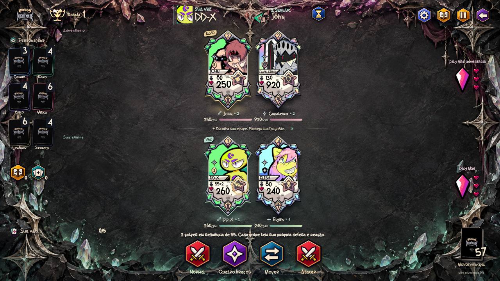

# GOGHOS — The Nightmare Is Coming

Um jogo de cartas e batalhas por velocidade no universo **GOGHOS**. A **v0.35.0** refaz Jogar, seleção e batalha com uma mesa ilustrada e emblemas facetados, seguindo o novo kit de referência do criador com um acabamento mais sóbrio.

## Cartas sobre a mesa

- **Jogar em destaque:** personagens oficiais, acesso principal próprio e atalhos com ícones grandes, sem a lista anterior de seis barras.
- **Seleção física:** os quatro Comuns aparecem como cartas soltas; as escolhas alternam entre jogador e bot, conservando a ordem inicial.
- **Uma arena aberta:** a frente, a retaguarda e as Daly Mães compartilham o campo, sem as grandes caixas por equipe nem o painel permanente de atributos. As consultas continuam disponíveis nos ícones.
- **Emblemas ilustrados:** doze símbolos com bases facetadas, metal e esmalte em cores contidas. A habilidade especial usa a estrela; ataque normal, confirmação, movimento e recursos mantêm seus próprios controles.
- **Protagonismo das cartas:** enquadramento considera os personagens presentes; as vagas livres são marcas discretas no chão. A mão fica em leque, os montes são peças clicáveis, e a estrela da própria carta abre suas opções de habilidade.

O balanceamento, as artes oficiais, a fonte German Beauty, as músicas e os efeitos de combate permanecem preservados. A hierarquia de velocidade, os ataques separados, os Apoios durante impedimentos e a recuperação continuam seguindo as regras existentes.



[Menu](docs/previews/menu-v0.35.0-desktop.png) · [Batalha no celular](docs/previews/arena-v0.35.0-celular.png) · [Seleção](docs/previews/selecao-v0.35.0-celular.png) · [Combate em movimento](docs/previews/combate-v0.35.0.mp4) · [Guia da interface](docs/UI.md) · [Validação](docs/VALIDACAO.md)

## Jogar e desenvolver

Abra `index.html` no navegador. O jogo roda localmente, sem conta, servidor ou internet. Extraia o ZIP completo antes de abrir o arquivo. A fonte original German Beauty é carregada dos arquivos locais do projeto. O som começa depois de uma interação; volume e movimento podem ser ajustados pelo ícone de preferências. Para servir os arquivos durante o desenvolvimento, execute `npm run dev` na raiz do projeto e acesse `http://localhost:8000`.

Com **Arena** selecionada, **Jogar** apresenta Elysh, Stally, Mike e Alex. A escolha alterna **você → bot → você → bot**, sem repetir cartas. Depois das quatro escolhas, clique em **Play · começar batalha**. Cada equipe começa com seus dois Comuns na frente; não são sorteados Raros.

No seletor de modos, **Treino de campeões** oferece uma formação para cada um dos 31 oficiais, com busca por nome e descrição da habilidade. As escolhas de entrada aparecem na pré-batalha; as ações específicas aparecem na vez do personagem. **Personagens** mostra o catálogo com as cartas e as regras de cada habilidade. **Mesa de Apoios** inclui os 17 efeitos; **Invocação primordial** prepara os três fragmentos para a invocação manual. Os **Atalhos de treino** mantêm os testes de Sark e Elétrica e John. A escolha do modo vale enquanto o jogo estiver aberto; recarregar retorna à Arena.

Foram adicionados combo de Sam, míssil com dano nos vizinhos, paralisia, duelo do Sheriff, hipnose, almas, queimaduras, cura total, caça sorteada, estado Oni, estrela de Unicorn, execução por dado, sono, petrificação, proteção de Z-Zus, Swarm de Alex, amizade de Karma e esquiva progressiva de Trucc. As regras completas estão no [guia dos personagens](docs/PERSONAGENS_PENDENTES.md). A [revisão de balanceamento](docs/BALANCEAMENTO.md) lista todos os valores anteriores, atuais e justificativas.

As cartas da mão podem ser usadas na vez da equipe mesmo se o personagem estiver imobilizado ou sob outro impedimento. Isso não gasta a ação nem remove o efeito. Magos mantêm 3 de mana inicial, +1 por ação concluída e máximo de 3.

É necessário **Node.js 20 ou superior** para rodar os testes e **Python 3** para `npm run dev`. Não há pacotes externos nem etapa de instalação:

```sh
npm test
```

## Onde está cada parte

| Caminho | Conteúdo |
| --- | --- |
| `js/data/` | Personagens, cartas de Apoio e cartas do monte principal |
| `js/core/` | Regras da batalha, seleção, IA, montes e recuperação |
| `js/ui/` | Telas, cartas, mão e mensagens |
| `assets/` e `css/` | Arte recebida, conceitos, fontes e aparência |
| `tests/` | Regras atuais e testes da interface com DOM simulado |
| `docs/` | Regras completas e histórico das versões recebidas |

[Conferência de classes e tributos](docs/CLASSES.md) · [Invocação e tributos](docs/DEUSES.md) · [Cartas de Apoio](docs/APOIOS.md) · [Balanceamento](docs/BALANCEAMENTO.md) · [Regras e decisões provisórias](docs/REGRAS.md) · [Validação e imagens](docs/VALIDACAO.md) · [Artes recebidas](docs/ARTES.md) · [Histórico](docs/HISTORICO.md) · [Como contribuir](CONTRIBUTING.md)

## Estado do protótipo

A partida pode ser concluída contra a IA. Há seis montes de personagens, monte principal, mão de cinco cartas, cartas de Apoio, pré-batalha, habilidades individuais, recuperação sem reiniciar a velocidade e vitória ao eliminar a Daly Mãe adversária. Vida, dano e cura são arredondados para cima em múltiplos de 5, com a exceção confirmada de Morto Vivo voltando com 1 de Vida. O contador da Daly Mãe perde uma vida por ataque.

Item e Habilidade Especial continuam em desenvolvimento. O Santuário oferece a loja de baús e visuais, separada das regras de combate. As habilidades dos 31 personagens presentes estão implementadas; Petra aguarda sua mecânica. Sem ação possível, é possível avançar o ciclo e comprar cartas; com os recursos esgotados e sem efeitos a resolver, há empate.


[Seleção no celular](docs/previews/selecao-v0.29.0-celular.png) · [Crônicas](docs/previews/cronicas-v0.29.0-celular.png) · [Guia da interface](docs/UI.md) · [Atualizações anteriores](docs/HISTORICO.md)
