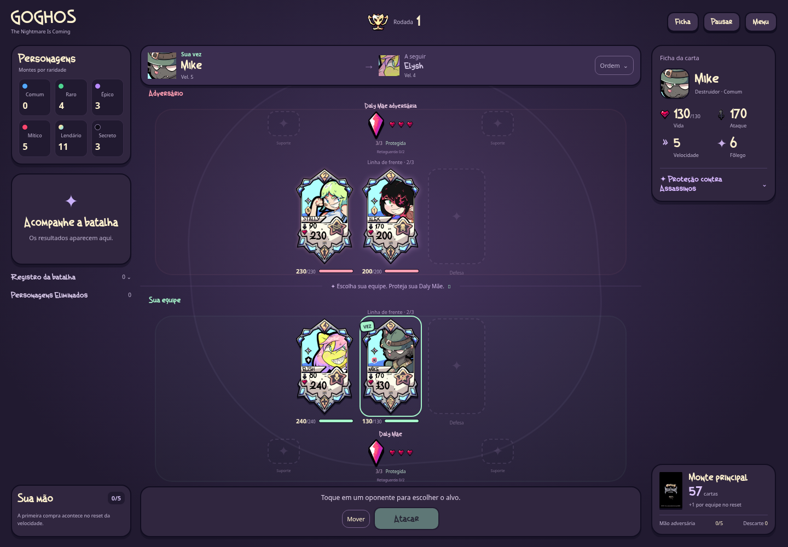

# GOGHOS TCG

Protótipo jogável de cartas e batalha por turnos. A versão **0.26.2** mantém as 29 cartas balanceadas e resolve multiplicadores como **golpes separados**: DD-X faz 2 de 45 ou 4 de 45 com sua habilidade; Draktar faz 2 de 90; Sam mantém até seis socos de 70. Cada golpe tem sua própria defesa, esquiva e reação. A proteção de Striker agora também impede a dimensão de Penxy quando Penxy é mais rápido; sem alvo permitido, a pré-batalha continua normalmente. Striker recebe o nome correto, Sam usa o ícone de Fighter e Linx entra com ataque de 30% da Vida máxima do alvo. [Tabela completa dos personagens atualizados](docs/BALANCEAMENTO_MANUAL.md).

O jogo mantém os 17 Apoios oficiais, a invocação de Zeenneriam pelos três Fragmentos Primordiais e a interface cartoon. São **31 personagens de raridade e um Deus separado**; Petra aguarda sua mecânica. A seleção continua com dois Comuns por equipe, sem Raros automáticos. Elysh também cura da retaguarda na sua vez.

## Jogar e desenvolver

Abra `index.html` no navegador. O jogo roda localmente, sem conta, servidor ou internet. Para servir os arquivos durante o desenvolvimento, execute `npm run dev` na raiz do projeto e acesse `http://localhost:8000`.

Em **Jogar**, aparecem Elysh, Stally, Mike e Alex. A escolha alterna **você → bot → você → bot**, sem repetir cartas. Depois das quatro escolhas, clique em **Play · começar batalha**. Cada equipe começa com seus dois Comuns na frente; não são sorteados Raros.

No menu **Treinar e testar**, **Personagens** oferece uma formação para cada um dos 31 oficiais, com busca por nome e descrição da habilidade. As escolhas de entrada aparecem na pré-batalha; as ações específicas aparecem na vez do personagem. **Personagens** mostra o catálogo com as cartas e as regras de cada habilidade. O menu **Testar cartas de Apoio** inclui os 17 efeitos; **Invocação de Zeenneriam** prepara os três fragmentos para a invocação manual. Os atalhos **Testar Sark** e **Testar Elétrica e John** continuam disponíveis.

Foram adicionados combo de Sam, míssil com dano nos vizinhos, paralisia, duelo do Sheriff, hipnose, almas, queimaduras, cura total, caça sorteada, estado Oni, estrela de Unicorn, execução por dado, sono, petrificação, proteção de Z-Zus, Swarm de Alex, amizade de Karma e esquiva progressiva de Trucc. As regras completas estão no [guia dos personagens](docs/PERSONAGENS_PENDENTES.md). A [revisão de balanceamento](docs/BALANCEAMENTO.md) lista todos os valores anteriores, atuais e justificativas.

As cartas da mão podem ser usadas na vez da equipe mesmo se o personagem estiver imobilizado ou sob outro impedimento. Isso não gasta a ação nem remove o efeito. Magos mantêm 3 de mana inicial, +1 por ação concluída e máximo de 3.

É necessário **Node.js 20 ou superior** para rodar os testes e **Python 3** para `npm run dev`. Não há pacotes externos nem etapa de instalação:

```sh
npm test
```

## Onde está cada parte

| Caminho | Conteúdo |
| --- | --- |
| `js/data/` | Personagens, cartas de Apoio e cartas do monte principal |
| `js/core/` | Regras da batalha, seleção, IA, montes e recuperação |
| `js/ui/` | Telas, cartas, mão e mensagens |
| `assets/` e `css/` | Arte recebida, conceitos, fontes e aparência |
| `tests/` | Regras atuais e testes da interface com DOM simulado |
| `docs/` | Regras completas e histórico das versões recebidas |

[Conferência de classes e tributos](docs/CLASSES.md) · [Invocação e tributos](docs/DEUSES.md) · [Cartas de Apoio](docs/APOIOS.md) · [Balanceamento](docs/BALANCEAMENTO.md) · [Regras e decisões provisórias](docs/REGRAS.md) · [Validação e imagens](docs/VALIDACAO.md) · [Artes recebidas](docs/ARTES.md) · [Histórico](docs/HISTORICO.md) · [Como contribuir](CONTRIBUTING.md)

## Estado do protótipo

A partida pode ser concluída contra a IA. Há seis montes de personagens, monte principal, mão de cinco cartas, cartas de Apoio, pré-batalha, habilidades individuais, recuperação sem reiniciar a velocidade e vitória ao eliminar a Daly Mãe adversária. Vida, dano e cura são arredondados para cima em múltiplos de 5, com a exceção confirmada de Morto Vivo voltando com 1 de Vida. O contador da Daly Mãe perde uma vida por ataque.

Item, Habilidade Especial e Loja continuam em desenvolvimento. As habilidades dos 31 personagens presentes estão implementadas; Petra aguarda sua mecânica. Sem ação possível, é possível avançar o ciclo e comprar cartas; com os recursos esgotados e sem efeitos a resolver, há empate.



[Seleção no celular](docs/previews/selecao-v0.25.0-celular.png) · [Cura da retaguarda](docs/previews/cura-v0.25.0-desktop.png) · [Guia da interface](docs/UI.md)

[Sam com ícone Fighter](docs/previews/sam-v0.26.0-desktop.png) · [Linx em batalha](docs/previews/linx-v0.26.0-desktop.png) · [Striker corrigido](docs/previews/striker-v0.26.0-celular.png)

[DD-X com quatro golpes](docs/previews/ddx-v0.26.1-desktop.png) · [Seis socos de Sam](docs/previews/sam-v0.26.1-registro.png) · [Regra dos golpes separados](docs/REGRAS.md#golpes-em-sequência--v0261)

[Penxy respeita a proteção de Striker](docs/previews/penxy-v0.26.2-desktop.png) · [Conferência no celular](docs/previews/penxy-v0.26.2-celular.png)
