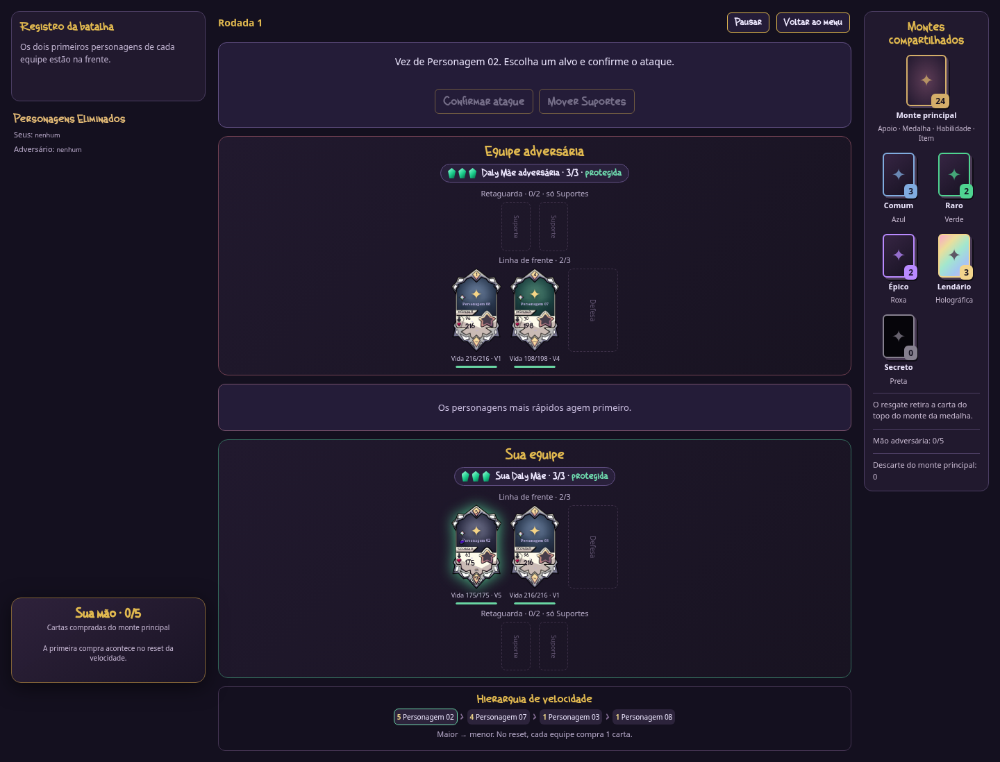

# GOGHOS TCG

Protótipo jogável de cartas e batalha por turnos. A versão **0.16.0** apresenta todos os Comuns na seleção, escolhas alternadas de dois personagens por equipe, arena com seis montes visíveis, medalhas por cor e movimentação de Suportes. O leque fica no canto inferior esquerdo e a batalha pausa para mostrar o resultado de cada ataque.

## Jogar e desenvolver

Abra `index.html` no navegador. O jogo roda localmente, sem conta, servidor ou internet. Para servir os arquivos durante o desenvolvimento, execute `npm run dev` na raiz do projeto e acesse `http://localhost:8000`.

É necessário **Node.js 20 ou superior** para rodar os testes e **Python 3** para `npm run dev`. Não há pacotes externos nem etapa de instalação:

```sh
npm test
```

## Onde está cada parte

| Caminho | Conteúdo |
| --- | --- |
| `js/data/` | Personagens, cartas de Apoio e cartas do monte principal |
| `js/core/` | Regras da batalha, seleção, IA, montes e recuperação |
| `js/ui/` | Telas, cartas, mão e mensagens |
| `assets/` e `css/` | Arte recebida, conceitos, fontes e aparência |
| `tests/` | Regras atuais e testes da interface com DOM simulado |
| `docs/` | Regras completas e histórico das versões recebidas |

[Regras e decisões provisórias](docs/REGRAS.md) · [Validação e imagens](docs/VALIDACAO.md) · [Artes recebidas](docs/ARTES.md) · [Histórico](docs/HISTORICO.md) · [Como contribuir](CONTRIBUTING.md)

## Estado do protótipo

A partida já pode ser concluída contra a IA. Há seleção inicial, cinco montes de personagens, compra do monte principal, cartas de Apoio, Esquiva, mana, recuperação e vitória ao eliminar a Daly Mãe adversária. A Loja, os efeitos de Item e Habilidade Especial e parte da arte continuam em desenvolvimento. Sam, Eletric e Sarck têm ilustrações recebidas e aparecem em **Personagens** no menu. Os outros nomes e retratos ainda são provisórios; os atributos seguem as faixas da v0.14, com os valores conhecidos de Eletric e da Vida de Sarck preservados.


