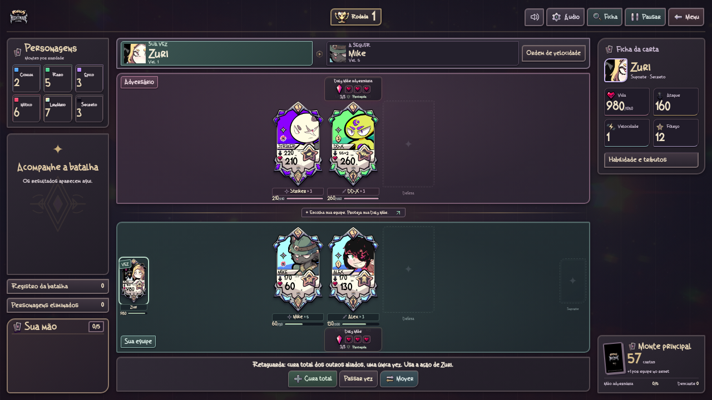
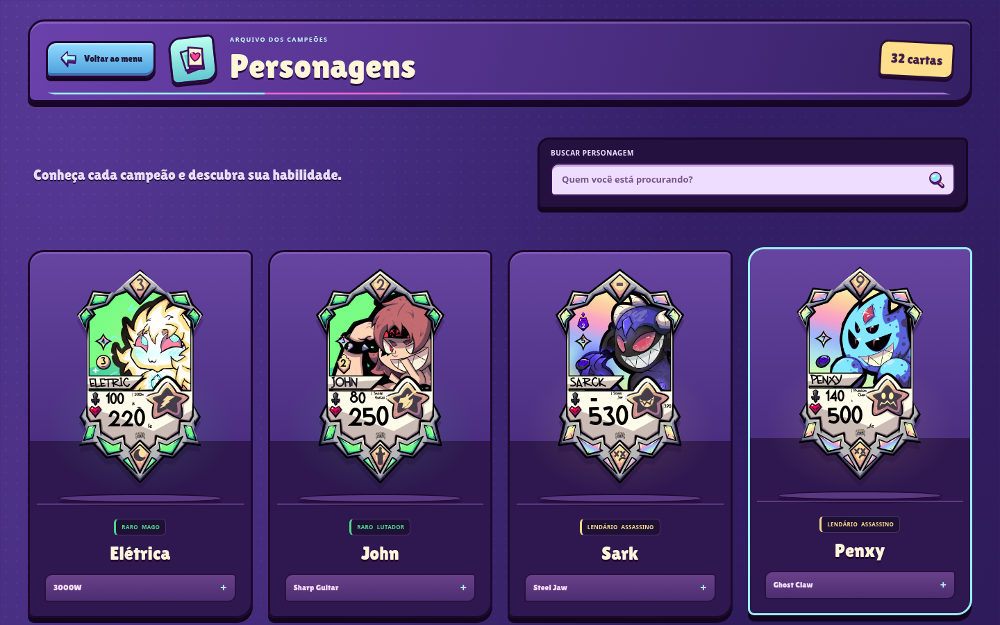

# GOGHOS — The Nightmare Is Coming

Um jogo de cartas e batalhas por velocidade no universo **GOGHOS**. A versão **0.32.0** aplica a rodada de balanceamento aprovada pelo criador. **Burn permanece igual**; o Oni de Daztirry dura **quatro ações globais**. As quatro músicas instrumentais, a direção gótica estilizada, a fonte original e a batalha sem rolagem continuam disponíveis.

| Personagem ou regra | Atualização |
| --- | --- |
| Rayvilin | Petrificar na própria vez permite executar somente a partir da próxima vez dela; na entrada, pode executar na primeira vez. |
| Unicorn | Estrela mantém +150 de Vida e +50 de ataque; velocidade passa de +2 para +1. |
| Chama | Mantém 55 iniciais; queimadura ofensiva passa a 40 por cinco aplicações; revide continua 35×3. |
| DD-X | 55 por golpe: dois normalmente ou quatro na ativação única. |
| Fonior | Vida passa de 260 para 320; almas continuam aumentando só o máximo. |
| Linx | Ataque passa de 30% para 35% da Vida máxima do alvo. |
| Zuri | Pode gastar sua ação para usar a cura única da retaguarda, sem curar a si mesma ou atacar dali. |
| Assassin | Esquiva natural limitada a cinco resultados do d6; 6 permite o acerto. Trucc e Striker mantêm suas regras próprias. |
| Daztirry | Oni passa de três para quatro ações de qualquer personagem; bônus de +30 e eliminação ao terminar mantidos. |

Striker continua com velocidade 3. Destruidores continuam ignorando o Parry dos Fighters. Artes oficiais preservadas; o jogo atualiza os números sobre as bases recebidas. Fôlego não recebeu regra de consumo.

[Ouvir a prévia das quatro trilhas](docs/previews/trilha-v0.31.0.mp3) · [Créditos e gravações](assets/music/README.md)



## Som e apresentação

- **Música:** menu e combate em repetição; vitória e derrota com finais próprios, sem vozes. Transições suaves, volume musical independente e som interrompido ao ocultar a aba. O primeiro clique/toque libera o áudio.
- **Menu e abertura:** painéis com acabamento de metal, ação principal em latão, ornamentos de arcos e iluminação suave. Os detalhes ilustrados conservam o aspecto estilizado.
- **Ícones:** 22 vetores locais com o mesmo acabamento de marfim, ferro, latão e cores espectrais discretas.
- **Batalha:** equipes em verde espectral e ameixa, superfícies mais sóbrias, ações e alvos destacados. Frente, retaguarda, Daly Mães, montes, mão e comandos continuam na tela.
- **Decisões e consultas:** mão cheia, recuperação, fichas, preferências e registro acompanham o tema e mantêm os controles por botões.
- **Catálogo, loja e crônicas:** molduras mais discretas, placas de título e painéis escuros. Cartas, personagens, produtos e suas cores originais continuam intactos.

[Arena no computador](docs/previews/arena-v0.30.0-desktop.png) · [Arena no celular](docs/previews/arena-v0.30.0-celular.png) · [Menu no celular](docs/previews/menu-v0.30.0-celular.png) · [Loja](docs/previews/loja-v0.30.0-desktop.png) · [Guia da interface](docs/UI.md)

## Jogar e desenvolver

Abra `index.html` no navegador. O jogo roda localmente, sem conta, servidor ou internet. Extraia o ZIP completo antes de abrir o arquivo. A fonte original German Beauty é carregada dos arquivos locais do projeto. O som começa depois de uma interação; volume e movimento podem ser ajustados pelo ícone de preferências. Para servir os arquivos durante o desenvolvimento, execute `npm run dev` na raiz do projeto e acesse `http://localhost:8000`.

Com **Arena** selecionada, **Jogar** apresenta Elysh, Stally, Mike e Alex. A escolha alterna **você → bot → você → bot**, sem repetir cartas. Depois das quatro escolhas, clique em **Play · começar batalha**. Cada equipe começa com seus dois Comuns na frente; não são sorteados Raros.

No seletor de modos, **Treino de campeões** oferece uma formação para cada um dos 31 oficiais, com busca por nome e descrição da habilidade. As escolhas de entrada aparecem na pré-batalha; as ações específicas aparecem na vez do personagem. **Personagens** mostra o catálogo com as cartas e as regras de cada habilidade. **Mesa de Apoios** inclui os 17 efeitos; **Invocação primordial** prepara os três fragmentos para a invocação manual. Os **Atalhos de treino** mantêm os testes de Sark e Elétrica e John. A escolha do modo vale enquanto o jogo estiver aberto; recarregar retorna à Arena.

Foram adicionados combo de Sam, míssil com dano nos vizinhos, paralisia, duelo do Sheriff, hipnose, almas, queimaduras, cura total, caça sorteada, estado Oni, estrela de Unicorn, execução por dado, sono, petrificação, proteção de Z-Zus, Swarm de Alex, amizade de Karma e esquiva progressiva de Trucc. As regras completas estão no [guia dos personagens](docs/PERSONAGENS_PENDENTES.md). A [revisão de balanceamento](docs/BALANCEAMENTO.md) lista todos os valores anteriores, atuais e justificativas.

As cartas da mão podem ser usadas na vez da equipe mesmo se o personagem estiver imobilizado ou sob outro impedimento. Isso não gasta a ação nem remove o efeito. Magos mantêm 3 de mana inicial, +1 por ação concluída e máximo de 3.

É necessário **Node.js 20 ou superior** para rodar os testes e **Python 3** para `npm run dev`. Não há pacotes externos nem etapa de instalação:

```sh
npm test
```

## Onde está cada parte

| Caminho | Conteúdo |
| --- | --- |
| `js/data/` | Personagens, cartas de Apoio e cartas do monte principal |
| `js/core/` | Regras da batalha, seleção, IA, montes e recuperação |
| `js/ui/` | Telas, cartas, mão e mensagens |
| `assets/` e `css/` | Arte recebida, conceitos, fontes e aparência |
| `tests/` | Regras atuais e testes da interface com DOM simulado |
| `docs/` | Regras completas e histórico das versões recebidas |

[Conferência de classes e tributos](docs/CLASSES.md) · [Invocação e tributos](docs/DEUSES.md) · [Cartas de Apoio](docs/APOIOS.md) · [Balanceamento](docs/BALANCEAMENTO.md) · [Regras e decisões provisórias](docs/REGRAS.md) · [Validação e imagens](docs/VALIDACAO.md) · [Artes recebidas](docs/ARTES.md) · [Histórico](docs/HISTORICO.md) · [Como contribuir](CONTRIBUTING.md)

## Estado do protótipo

A partida pode ser concluída contra a IA. Há seis montes de personagens, monte principal, mão de cinco cartas, cartas de Apoio, pré-batalha, habilidades individuais, recuperação sem reiniciar a velocidade e vitória ao eliminar a Daly Mãe adversária. Vida, dano e cura são arredondados para cima em múltiplos de 5, com a exceção confirmada de Morto Vivo voltando com 1 de Vida. O contador da Daly Mãe perde uma vida por ataque.

Item e Habilidade Especial continuam em desenvolvimento. O Santuário oferece a loja de baús e visuais, separada das regras de combate. As habilidades dos 31 personagens presentes estão implementadas; Petra aguarda sua mecânica. Sem ação possível, é possível avançar o ciclo e comprar cartas; com os recursos esgotados e sem efeitos a resolver, há empate.



[Seleção no celular](docs/previews/selecao-v0.29.0-celular.png) · [Crônicas](docs/previews/cronicas-v0.29.0-celular.png) · [Guia da interface](docs/UI.md) · [Atualizações anteriores](docs/HISTORICO.md)
