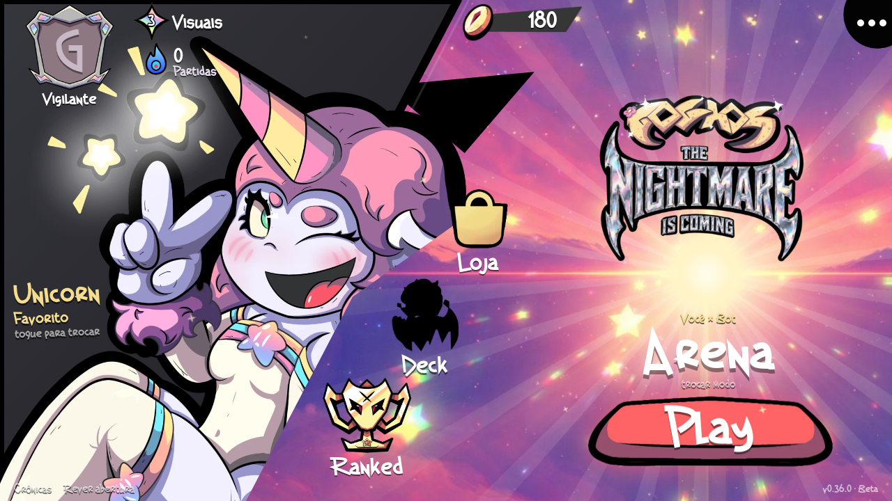

# GOGHOS — The Nightmare Is Coming

Um jogo de cartas e batalhas por velocidade no universo **GOGHOS**. A **v0.36.1** usa as músicas enviadas para batalha, vitória e derrota. A abertura aparece em toda inicialização, não pode ser pulada e entra no menu automaticamente quando termina. O menu cósmico, os favoritos e as regras de combate permanecem iguais.

## Abertura e menu

- **Menu enviado:** cenário cósmico, painel diagonal, logo GOGHOS, personagem favorito alternável e Play. Os ícones abrem Loja, Deck, modos e Configurações reais; moedas, partidas e visuais mostram o progresso local.
- **Seleção física:** os quatro Comuns aparecem como cartas soltas; as escolhas alternam entre jogador e bot, conservando a ordem inicial.
- **Uma arena aberta:** a frente, a retaguarda e as Daly Mães compartilham o campo, sem as grandes caixas por equipe nem o painel permanente de atributos. As consultas continuam disponíveis nos ícones.
- **Emblemas ilustrados:** doze símbolos com bases facetadas, metal e esmalte em cores contidas. A habilidade especial usa a estrela; ataque normal, confirmação, movimento e recursos mantêm seus próprios controles.
- **Protagonismo das cartas:** enquadramento considera os personagens presentes; as vagas livres são marcas discretas no chão. A mão fica em leque, os montes são peças clicáveis, e a estrela da própria carta seleciona a habilidade diretamente, sem abrir outro painel.

O balanceamento, as artes oficiais, a fonte German Beauty e os efeitos de combate permanecem preservados. A abertura, o menu, a batalha e os resultados usam as trilhas enviadas pelo criador. A hierarquia de velocidade, os ataques separados, os Apoios durante impedimentos e a recuperação continuam seguindo as regras existentes.



[Abertura](docs/previews/intro-v0.36.1-desktop.png) · [Menu no celular](docs/previews/menu-v0.36.0-celular.png) · [Batalha no celular](docs/previews/arena-v0.35.1-celular.png) · [Seleção](docs/previews/selecao-v0.35.1-celular.png) · [Habilidade direta](docs/previews/habilidade-v0.35.3-celular.png) · [Guia da interface](docs/UI.md) · [Validação](docs/VALIDACAO.md)

## Jogar e desenvolver

Abra `index.html` no navegador. Em toda inicialização, toque em **Toque para iniciar**; ao terminar a animação, o menu aparece automaticamente. A abertura não oferece Pular nem entrada antecipada; Escape não a encerra. Se um recurso não carregar, use **Tentar novamente** para repetir o carregamento e concluir a abertura. **Rever abertura** continua disponível no menu. O jogo roda localmente, sem conta, servidor ou internet. Extraia o ZIP completo antes de abrir o arquivo. A fonte original German Beauty é carregada dos arquivos locais do projeto. O som começa depois de uma interação; volume e movimento podem ser ajustados nas Configurações. A intro usa os arquivos recebidos e respeita as preferências de áudio e movimento reduzido, sem tocar a música do menu ao mesmo tempo. Para servir os arquivos durante o desenvolvimento, execute `npm run dev` na raiz do projeto e acesse `http://localhost:8000`.

Com **Arena** selecionada, **Jogar** apresenta Elysh, Stally, Mike e Alex. A escolha alterna **você → bot → você → bot**, sem repetir cartas. Depois das quatro escolhas, clique em **Play · começar batalha**. Cada equipe começa com seus dois Comuns na frente; não são sorteados Raros.

No seletor de modos, **Treino de campeões** oferece uma formação para cada um dos 31 oficiais, com busca por nome e descrição da habilidade. As escolhas de entrada aparecem na pré-batalha; as ações específicas aparecem na vez do personagem. A estrela prepara a habilidade; o botão principal confirma o efeito e mostra seu nome. Outro toque volta ao ataque normal. A cura de Elysh na retaguarda já fica selecionada. **Personagens** mostra o catálogo com as cartas e as regras de cada habilidade. **Mesa de Apoios** inclui os 17 efeitos; **Invocação primordial** prepara os três fragmentos para a invocação manual. Os **Atalhos de treino** mantêm os testes de Sark e Elétrica e John. A escolha do modo vale enquanto o jogo estiver aberto; recarregar retorna à Arena.

Foram adicionados combo de Sam, míssil com dano nos vizinhos, paralisia, duelo do Sheriff, hipnose, almas, queimaduras, cura total, caça sorteada, estado Oni, estrela de Unicorn, execução por dado, sono, petrificação, proteção de Z-Zus, Swarm de Alex, amizade de Karma e esquiva progressiva de Trucc. As regras completas estão no [guia dos personagens](docs/PERSONAGENS_PENDENTES.md). A [revisão de balanceamento](docs/BALANCEAMENTO.md) lista todos os valores anteriores, atuais e justificativas.

As cartas da mão podem ser usadas na vez da equipe mesmo se o personagem estiver imobilizado ou sob outro impedimento. Isso não gasta a ação nem remove o efeito. Magos mantêm 3 de mana inicial, +1 por ação concluída e máximo de 3.

É necessário **Node.js 20 ou superior** para rodar os testes e **Python 3** para `npm run dev`. Não há pacotes externos nem etapa de instalação:

```sh
npm test
```

## Onde está cada parte

| Caminho | Conteúdo |
| --- | --- |
| `js/data/` | Personagens, cartas de Apoio e cartas do monte principal |
| `js/core/` | Regras da batalha, seleção, IA, montes e recuperação |
| `js/ui/` | Telas, cartas, mão e mensagens |
| `assets/` e `css/` | Arte recebida, conceitos, fontes e aparência |
| `tests/` | Regras atuais e testes da interface com DOM simulado |
| `docs/` | Regras completas e histórico das versões recebidas |

[Conferência de classes e tributos](docs/CLASSES.md) · [Invocação e tributos](docs/DEUSES.md) · [Cartas de Apoio](docs/APOIOS.md) · [Balanceamento](docs/BALANCEAMENTO.md) · [Regras e decisões provisórias](docs/REGRAS.md) · [Validação e imagens](docs/VALIDACAO.md) · [Artes recebidas](docs/ARTES.md) · [Histórico](docs/HISTORICO.md) · [Como contribuir](CONTRIBUTING.md)

## Estado do protótipo

A partida pode ser concluída contra a IA. Há seis montes de personagens, monte principal, mão de cinco cartas, cartas de Apoio, pré-batalha, habilidades individuais, recuperação sem reiniciar a velocidade e vitória ao eliminar a Daly Mãe adversária. Vida, dano e cura são arredondados para cima em múltiplos de 5, com a exceção confirmada de Morto Vivo voltando com 1 de Vida. O contador da Daly Mãe perde uma vida por ataque.

Item e Habilidade Especial continuam em desenvolvimento. O Santuário oferece a loja de baús e visuais, separada das regras de combate. As habilidades dos 31 personagens presentes estão implementadas; Petra aguarda sua mecânica. Sem ação possível, é possível avançar o ciclo e comprar cartas; com os recursos esgotados e sem efeitos a resolver, há empate.


[Seleção no celular](docs/previews/selecao-v0.29.0-celular.png) · [Crônicas](docs/previews/cronicas-v0.29.0-celular.png) · [Habilidade direta](docs/previews/habilidade-v0.35.3-celular.png) · [Guia da interface](docs/UI.md) · [Atualizações anteriores](docs/HISTORICO.md)

### Regressão de cliques no navegador

Com Playwright disponível no ambiente e o servidor de `npm run dev` aberto, execute `npm run test:hand-browser`. O teste opcional confere as cinco cartas por mouse, toque e teclado, Apoio durante paralisia e substituição de mão cheia. `TEST_URL` permite outro servidor; `CHROMIUM_PATH` aponta para um Chromium local. O jogo e `npm test` continuam sem dependências externas.

### Os novos arquivos enviados

A intro de `GOGHOS, tela de carregamento.html` e o menu de `Cosmos — Menu Principal.html` foram integrados como componentes locais. Os recursos originais estão em [assets/intro-v036](assets/intro-v036/README.md) e [assets/menu-v036](assets/menu-v036/README.md), com manifestos de integridade. O título visível permanece **GOGHOS — The Nightmare Is Coming**.

O menu se adapta ao retrato sem girar os controles; tocar no personagem troca o favorito e salva apenas essa preferência visual. O acesso **Ranked** apresenta uma prévia e o caminho para a Arena: regras e recompensas competitivas ainda não foram definidas. Os controles dos treinos, coleção e crônicas continuam acessíveis.

### Trilhas da batalha e dos resultados

As três faixas foram integradas sem recodificação em [assets/music-v0361](assets/music-v0361/README.md): `BattleMusic.mp3` toca em laço na batalha; `WinMusic.mp3` e `DefeatMusicc.mp3` tocam uma vez nos respectivos resultados. Mute, volumes, pausa, transições e suspensão ao ocultar a aba mantêm os controles existentes.
