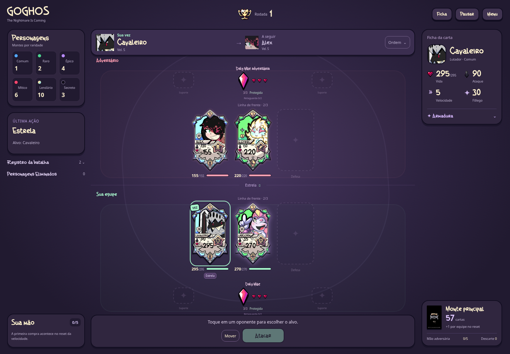

# Interface — v0.24.0

A arena usa formas arredondadas, contornos escuros e uma paleta roxa. Menta identifica sua equipe; coral identifica o adversário; dourado marca o alvo escolhido. As artes integrais dos personagens e os números da batalha continuam nos campos próprios.

## Jogar e acompanhar

- **Sua vez / Em ação:** a faixa acima do campo mostra quem age e quem vem a seguir. **Ordem** expande a fila de velocidade.
- **Escolher e confirmar:** toque em um adversário para marcar **ALVO**. A instrução informa o dano previsto e avisa sobre revide quando aplicável. Confirme em **Atacar**. Habilidades oferecem botões específicos, como **Cravar**, **Curar** e **Quatro braços**.
- **Resultado:** números aparecem sobre as cartas. O painel da última ação mostra quem recebeu dano, curou, defendeu, esquivou ou revidou, com Vida antes/depois. O resumo entre as equipes abre o registro completo.
- **Cartas da mão:** selecione a carta, escolha o alvo quando necessário e confirme. O limite de cinco, substituição, medalhas e Apoios durante impedimentos continuam funcionando.
- **Ficha:** abre atributos, habilidade, tributos e todos os estados do personagem consultado. Clicar em uma carta que não está sendo selecionada para uma ação também abre sua ficha. Após selecionar um alvo, **Ficha** permite conferir esse personagem.
- **Pausar:** interrompe o andamento. Ficha e registro ampliados também suspendem os temporizadores; **Voltar à batalha** retoma a leitura ou a jogada do bot. Ler não gasta ação, mana ou cartas.

Na carta ficam no máximo duas etiquetas de estado e uma contagem dos restantes. A ficha mostra todos. Passivas permanentes ficam na descrição para reduzir texto no campo.

## Resultados e ritmo

Combo, área, queimadura e revide mantêm suas regras. A interface soma impactos do mesmo efeito e alvo para facilitar a leitura e informa quantos aconteceram. Cada soco de Sam continua sendo um golpe separado com defesa e reação próprias; revide e cura aparecem separados do dano principal. O histórico preserva os registros do motor.

Os tempos permanecem: bot pensa por 1,8 segundo; resultado aparece por 2,2 segundos, ou 4,4 quando há vários impactos. Decisões do jogador não têm limite de tempo. A preferência de movimento reduzido desativa animações decorativas.

## Computador, celular e teclado

No computador, montes de personagens, resultado e mão ficam à esquerda; formação no centro; ficha e monte principal à direita. Em telas baixas, o campo admite rolagem para acomodar equipes completas e a ordem expandida.

No celular, os montes viram contagens compactas, a instrução e os comandos ficam acima das formações e a mão permanece acessível embaixo. A arena reserva o espaço medido da mão e rola para mostrar os demais painéis. [Ver arena no celular](previews/arena-v0.24.0-celular.png).

Use **Tab** para navegar, **Enter/Espaço** para selecionar cartas e **Escape** para fechar ficha ou registro ampliados. A seleção por teclado leva o foco para a confirmação disponível.

O menu destaca **Jogar** e **Personagens**. Os laboratórios, invocação, testes de Apoio e Loja ficam em **Treinar e testar**.

[Resultado de combo](previews/combo-v0.24.0-desktop.png) · [Ficha no celular](previews/ficha-v0.24.0-celular.png) · [Validação](VALIDACAO.md)
