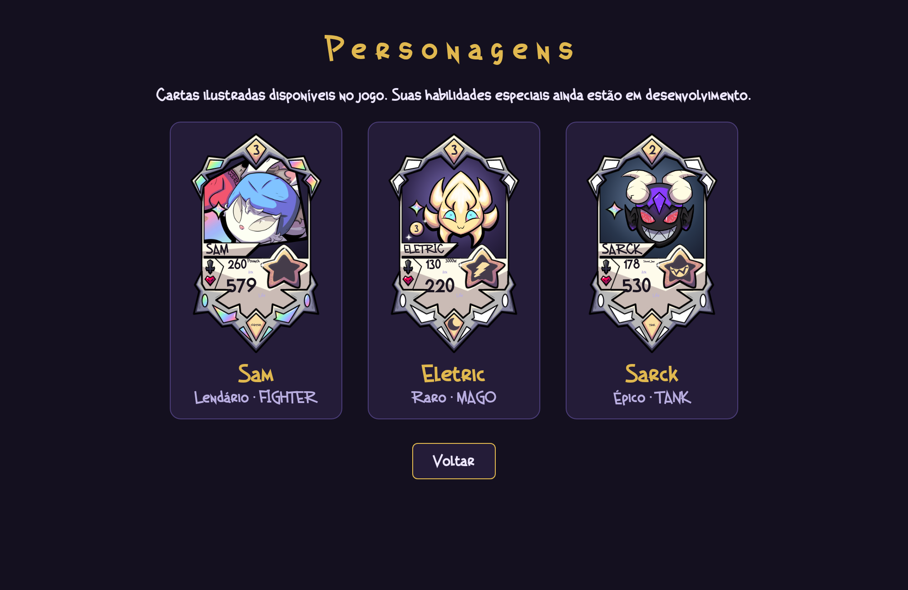

# Validação da v0.15.1

## Testes automatizados

`npm test`: 23 testes aprovados, incluindo uma simulação de 100 partidas completas. Cobrem limites de formação e mão, conservação de cartas, fim de partida, recuperação incompleta, repetição de cliques e pausa para decisões pendentes.

## Revisão no navegador

Chromium com Playwright em resoluções de 1280×800, 390×844 e 360×640 (celulares simulados pelo tamanho da janela).

Em cada resolução foram exercitadas as duas escolhas do caso informado:

1. Eliminar os personagens do jogador e atacar sua Daly Mãe, deixando 2 Comuns, 1 Raro e 0 Épicos nos montes.
2. Conferir os rótulos e o bloqueio apenas da opção Épico. Verificar que outro painel não intercepta o clique.
3. Escolher Comum e receber 2 personagens; repetir em outra partida escolhendo Raro e recebendo 1.
4. Verificar que a Daly Mãe continua com 2 vidas, fica protegida e a recuperação fecha.
5. Forçar o reset seguinte com a mão cheia, substituir uma carta e conferir a retomada sem nova compra duplicada.

Os seis fluxos passaram sem exceções JavaScript ou rolagem horizontal. A galeria foi conferida em desktop e celular: proporções preservadas, rostos visíveis, nomes e atributos em camadas separadas. Eletric e Sarck usam retratos avulsos; Sam usa o banner ilustrado enquanto não há retrato próprio separado. Os símbolos de raio e mandíbula correspondem a Eletric e Sarck, respectivamente.

[Ver a escolha de recuperação no celular](previews/recuperacao-v0.15.1.png)

As habilidades especiais continuam em desenvolvimento. Essa validação cobre os fluxos descritos, sem substituir testes com todas as futuras artes e regras.
